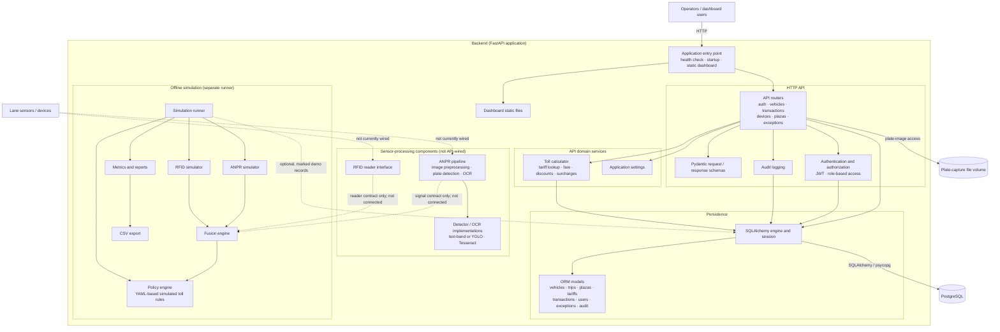

# Backend Component Diagram

The diagram shows the implemented backend boundaries. The API and offline
simulation are separate execution paths; the ANPR pipeline is implemented as a
swappable component but is not currently connected to either path.

## Reading the diagram

- The FastAPI application exposes the API and serves the dashboard's static
  files. API routers validate payloads with Pydantic schemas and use shared
  authentication, authorization, auditing, and database components.
- Vehicle toll charging uses the toll calculator and persisted vehicle,
  plaza, trip, tariff, and transaction data. The toll calculator currently
  reads database tariffs; the YAML policy engine shown below belongs to the
  separate simulation path.
- The simulation runner uses simulated ANPR and RFID reads, combines them in
  the fusion engine, and evaluates simulated toll rules. By default it writes
  metrics and reports through CSV export without touching the API database.
  An explicit persistence option can add clearly marked demo transactions
  and exceptions to the database; it does not change vehicle balances.
- The ANPR pipeline and RFID reader interfaces exist as backend components,
  but live lane sensor integration and API processing are not currently
  wired up.
